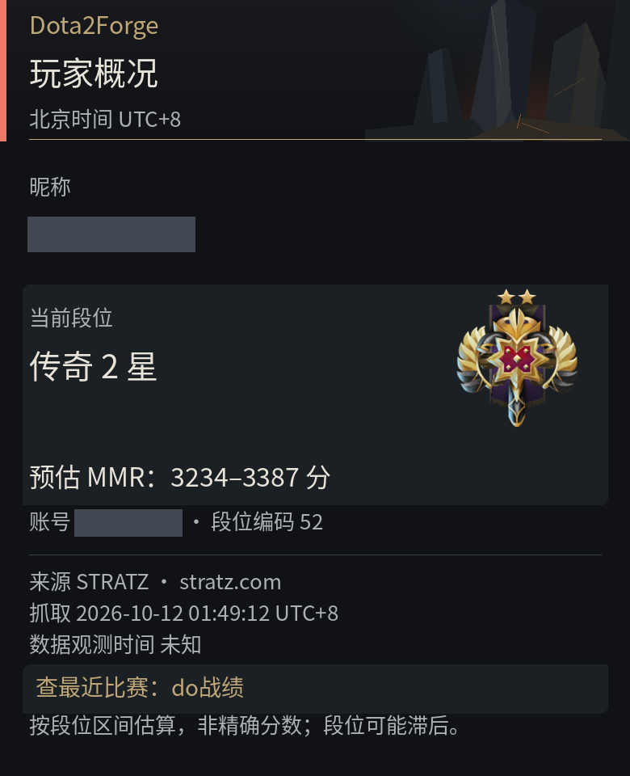
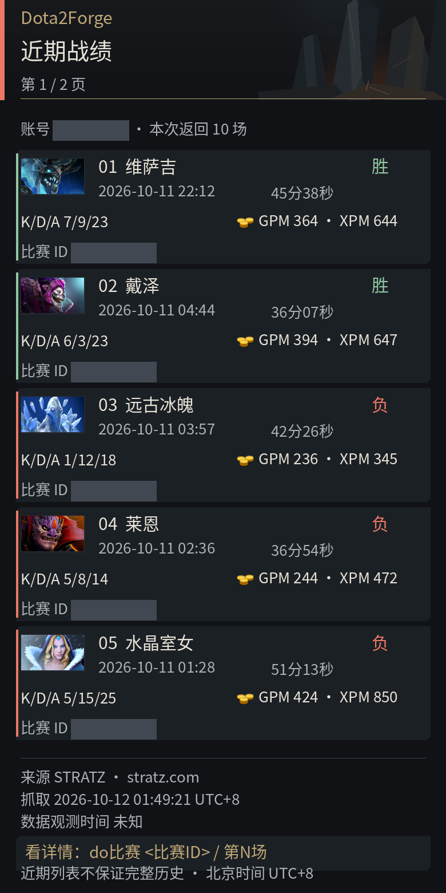
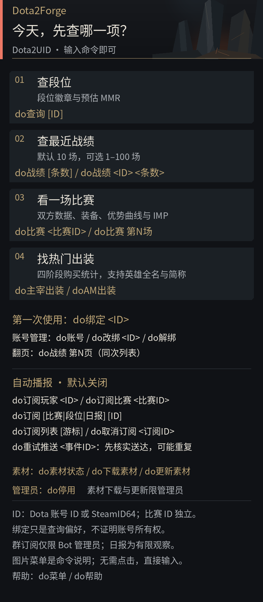
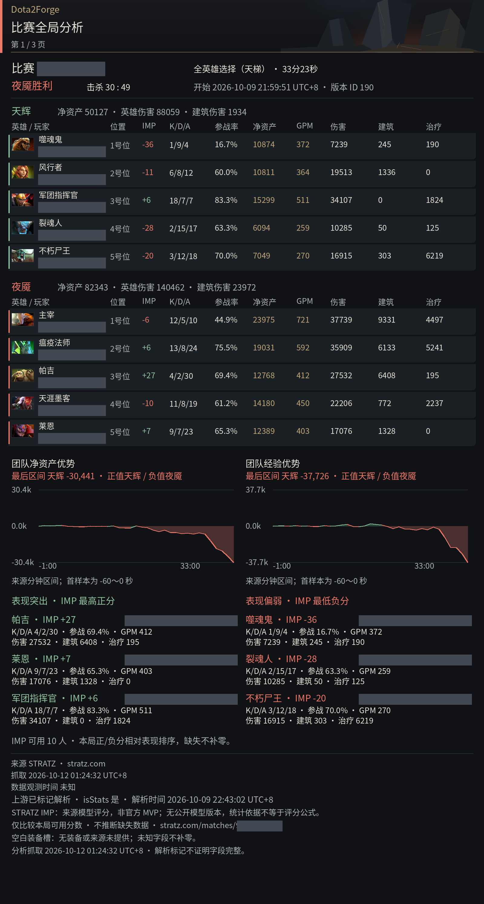
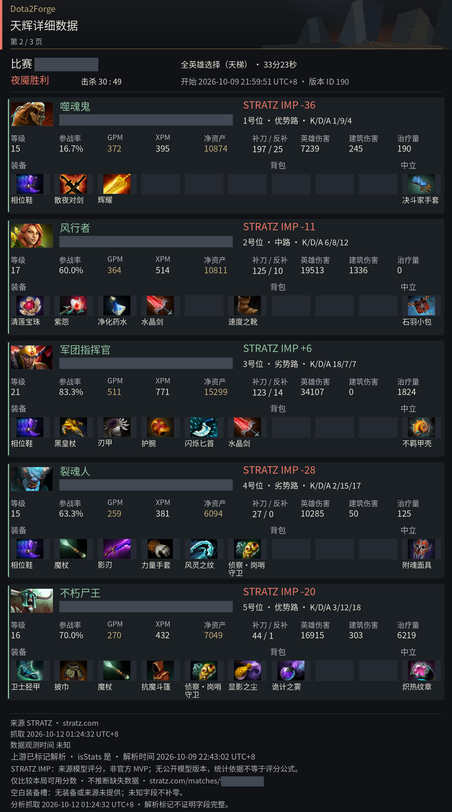
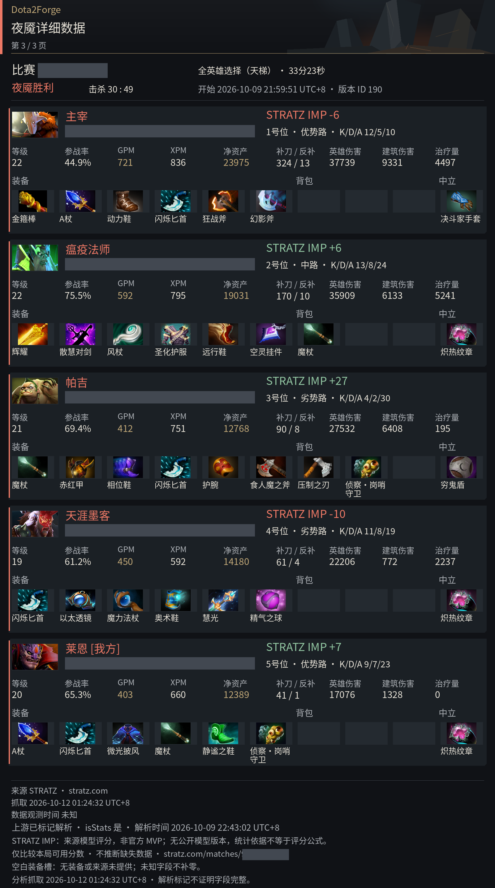
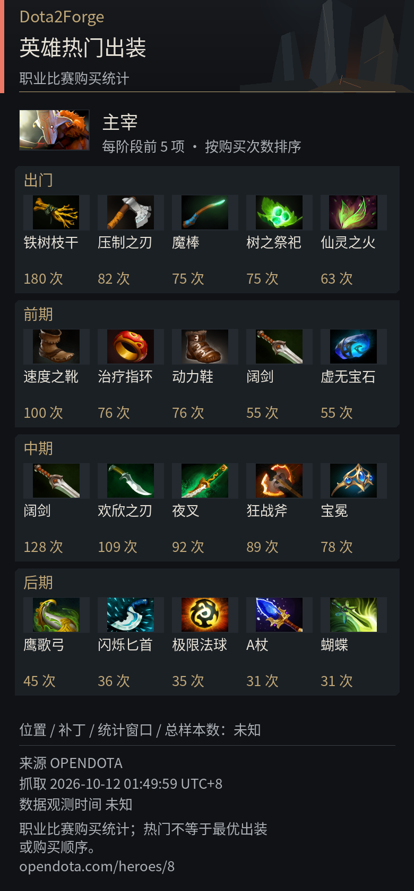

<p align="center">
  
</p>

<h1 align="center">Dota2UID</h1>

<p align="center">在聊天中查询 Dota 2 玩家、战绩、比赛报告和英雄热门出装。</p>

[安装指南](INSTALL.md) · [版本发布](https://github.com/HBLADEH/Dota2UID/releases) · [Dota2Forge](https://github.com/HBLADEH/Dota2Forge/blob/15e1a50a07273c645f0a1066b61fe266dde216cc/README.md) · [问题反馈](https://github.com/HBLADEH/Dota2Forge/issues)

> 发行版本：`0.1.0a13` · [目标分发仓库](https://github.com/HBLADEH/Dota2UID)。由主仓同一源码生成。

适用于 GsCore 的 Dota 2 查询扩展，与 AstrBot 插件共用 Dota2Forge 核心和图片渲染器。当前处于 **M0 预发行**阶段。

## 功能

- **玩家查询**：账号绑定、玩家概况、段位和预估 MMR。
- **近期战绩**：查询最近 1–100 场比赛，支持分页和按列表序号查看详情。
- **比赛报告**：总览与两队详情，展示英雄、装备、统计、团队优势曲线及来源提供的 STRATZ IMP。
- **英雄热门出装**：按出门、前期、中期、后期展示 OpenDota 职业比赛物品购买统计。
- **订阅通知**：玩家新比赛、指定比赛完成、段位变化和每日战报；默认关闭。

默认使用“远古锻炉”主题图片回复，也可配置文字模式。来源未提供的字段保留缺失说明。

## 效果展示

以下截图来自 **GsCore / Dota2UID**，两端共用图片渲染器与“远古锻炉”主题。昵称和账号／比赛 ID 已脱敏，原图分辨率保留；来源见[截图记录](https://github.com/HBLADEH/Dota2Forge/blob/15e1a50a07273c645f0a1066b61fe266dde216cc/docs/assets/screenshots/README.md)。

<table>
  <tr>
    <th>玩家概况与预估 MMR</th>
    <th>近期战绩</th>
  </tr>
  <tr>
    <td valign="top"></td>
    <td valign="top"></td>
  </tr>
</table>

[查看玩家原图](screenshots/player.png) · [查看战绩原图](screenshots/recent.png)

<details>
<summary>查看命令菜单</summary>



[查看原图](screenshots/menu.png)

</details>

<details>
<summary>查看比赛报告：总览与优势曲线</summary>



[查看原图](screenshots/match-overview.png)

</details>

<details>
<summary>查看比赛报告：天辉详细数据</summary>



[查看原图](screenshots/match-radiant.png)

</details>

<details>
<summary>查看比赛报告：夜魇详细数据</summary>



[查看原图](screenshots/match-dire.png)

</details>

<details>
<summary>查看英雄热门出装</summary>



[查看原图](screenshots/hero-items.png)

</details>

## 安装与首次配置

要求 **Python 3.12+、GsCore**，宿主需提供兼容的 HTTPX 和 Pillow。

1. 通过 GsCore 的 URL 安装功能添加本分发仓库，然后完整重启宿主。仓库携带匹配的四个项目运行包，启动时校验并准备插件专用运行目录，不需要先安装本项目 PyPI 包。
2. 用主人身份发送 `do核心状态` 查看准备和加载结果。缺包或校验失败时发送 `do安装核心`，按提示完成恢复后重载插件。恢复只使用清单固定版本与 SHA256，不接受聊天 URL、版本或 pip 参数。
3. 在后台 **插件配置 → Dota2UID → 插件参数配置** 填写 STRATZ Token 和独立 `namespace`，点击确认修改。保存后先 `do停用`，确认关闭再重载当前插件；旧 a6–a9 首次升级本版须完整冷启动。Token 不发送到聊天。

`do帮助` / `do菜单` 在运行库未就绪时返回文字提示；配置未完成单独显示。HTTPX、Pillow 继续使用宿主兼容版本，第三方冲突须按 [安装指南](INSTALL.md)维护。运行中的安装或修复只准备新运行库，兼容更新通过受控重载启用；状态分别显示期望、准备、运行版本与摘要。未知消费者、schema/第三方变化或关闭超时仍需冷启动；已有绑定和配置保留。详细安装、更新与回退见同一指南。

这是随包预发行版本，安装与恢复步骤见[安装指南](INSTALL.md)。

## 快速开始

将 `<…>` 替换为自己的值；命令表中的 `[…]` 表示可省略。

```text
do绑定 <Dota账号ID或SteamID64>
do查询
do战绩 20
do战绩 第3页
do比赛 第1场
do主宰出装
```

显式查询其他账号或直接查询比赛无需绑定；绑定只保存自己的查询偏好，不证明 Steam 账号所有权。

## 命令

| 命令 | 说明 |
| --- | --- |
| `do菜单` / `do帮助` | 查看命令帮助 |
| `do绑定 <ID>` / `do改绑 <ID>` | 绑定自己的账号 / 更换绑定 |
| `do账号` / `do解绑` | 查看绑定 / 解除绑定 |
| `do查询 [ID]` | 玩家概况、段位和预估 MMR |
| `do战绩 [条数]` | 查询自己的近期比赛，默认 10 场 |
| `do战绩 <ID> <条数>` | 查询指定账号的近期比赛 |
| `do战绩 第N页` | 查看本会话最后一次有效战绩的指定页 |
| `do比赛 <比赛ID>` / `do比赛 第N场` | 查询比赛报告 / 按列表绝对序号选择比赛 |
| `do主宰出装` / `doAM出装` / `do出装 Shadow Fiend` | 按英雄中文名、英文名或简称查询热门出装 |

账号参数接受数字形式的 Dota account ID 或 SteamID64，不接受主页 URL、vanity 或 `@他人`。战绩每页五场，首次最多发送两页；列表在同一会话保留十分钟，改绑、解绑、停用或重载后需重新查询。

### 订阅

启用 `subscriptions_enabled` 后可使用以下命令。群内创建订阅和重试推送需要 Bot 管理员权限。

| 命令 | 说明 |
| --- | --- |
| `do订阅玩家 <玩家ID>` | 发现玩家新完成的比赛后发送报告 |
| `do订阅比赛 <比赛ID>` | 指定比赛完成后通知一次 |
| `do订阅 [比赛\|段位\|日报] [ID]` | 订阅玩家通知，省略 ID 时使用绑定账号 |
| `do订阅列表 [游标]` / `do取消订阅 <订阅ID>` | 查看本人当前会话的订阅 / 取消订阅 |
| `do重试推送 <事件ID>` | 核实是否已送达后人工重试，可能重复 |

首次比赛、段位轮询只建立基线，不补发历史。日报按北京时间统计前一天开始的有限比赛窗口，最多 100 场。失败推送不自动重发；双端部署时需确定推送归属。配置和投递规则见[订阅指南](https://github.com/HBLADEH/Dota2Forge/blob/15e1a50a07273c645f0a1066b61fe266dde216cc/docs/cookbook/subscriptions.md)，真实主动推送仍待验收。

### 管理

| 命令 | 权限与说明 |
| --- | --- |
| `do核心状态` / `do安装核心` | 随包版、宿主主人；查看 / 准备或恢复运行库 |
| `do素材状态` | 查看素材准备进度 |
| `do下载素材` / `do更新素材` | 宿主主人；补齐 / 更新托管素材 |
| `do停用` | 宿主主人；关闭插件资源 |

核心安装和停用要求宿主主人权限 0；群主或群管理员权限不能代替。

## 配置

在 GsCore 后台参数页设置；保存后停用并重载插件，使配置生效。

| 参数 | 默认值 | 用途 |
| --- | --- | --- |
| STRATZ Token | 空 | 玩家和比赛查询的访问凭据 |
| 部署 namespace | `dota2uid-local` | 部署身份分区；不同部署使用不同值，修改后旧绑定不会自动迁移 |
| 回复模式 | `image` | `image` 图片或 `text` 文字 |
| 素材下载模式 | `auto` | 首次图片模式后台准备素材；也可选 `manual` 或 `off` |
| 自定义素材路径 | 空 | 留空使用托管素材；非空优先使用自定义目录 |
| 启用订阅 | `false` | 启用订阅与主动推送 |

首次素材准备完成前可使用占位卡片，已有完整快照会复用。用 `do素材状态` 查看进度；全部参数见[后台配置指南](https://github.com/HBLADEH/Dota2Forge/blob/15e1a50a07273c645f0a1066b61fe266dde216cc/docs/cookbook/gscore-configuration.md)。首次导入旧 TOML 后保留原文件，之后以后台 JSON 配置为准。

## 数据说明

- 玩家和比赛来自 **STRATZ**，热门出装来自 **OpenDota**；数据覆盖取决于账号隐私、来源解析状态和接口可用性。
- MMR 是根据段位换算的区间或下界，**不是精确天梯分**。STRATZ IMP 是来源的本局表现分，不等同官方 MVP。
- 热门出装展示购买次数，不代表最优出装或购买顺序；缺失字段不会补零，请求失败不会伪装成无战绩。
- 图片绘制失败时回退为同次查询的文字结果；消息发送失败不自动重发。

英雄攻略和 AI Tool 尚未实现；其他平台及当前主题的完整聊天效果仍需独立验收。

## 更新与排障

更新前备份插件数据。旧 a6–a9 首次升级需先 `do停用`、退出宿主、更新分发目录再冷启动。新版兼容的随包运行库更新可通过受控重载启用，用 `do核心状态` 确认实际运行版本；数据格式变化、依赖冲突或关闭超时仍需冷启动。卸载前先停用，保留专用数据目录。

- **等待配置**：填写 Token 和 namespace，保存后停用并重载。
- **运行库未就绪**：用主人身份查看 `do核心状态`，按提示恢复。
- **找不到第 N 场**：在同一会话重新查询战绩，或直接传比赛 ID。
- **英雄或装备缺图**：查看素材状态；检查下载模式、代理或自定义目录。

完整步骤见[安装与更新指南](INSTALL.md)。反馈问题时附插件版本、宿主版本、复现命令及脱敏错误信息。开发贡献见[开发指南](https://github.com/HBLADEH/Dota2Forge/blob/15e1a50a07273c645f0a1066b61fe266dde216cc/docs/cookbook/development.md)。

## 致谢与许可

感谢 GsCore、STRATZ 和 OpenDota。代码使用 [MIT 许可证](LICENSE)。Dota 2 及相关角色、美术权利属于 Valve；项目图标为独立生成的同人插画。第三方素材与字体遵循各自许可，见[素材说明](https://github.com/HBLADEH/Dota2Forge/blob/15e1a50a07273c645f0a1066b61fe266dde216cc/docs/cookbook/illustrations.md)。
